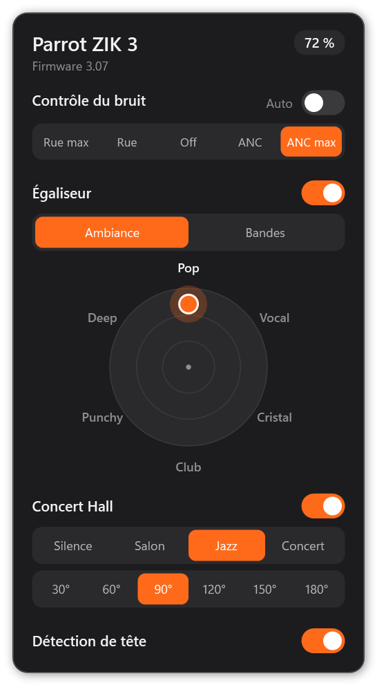

# ZikTray

Application Windows pour régler un casque **Parrot Zik 3** (ou Zik 2) depuis la zone de notification, sans l'appli iPhone/Android.



## Fonctions

- Batterie affichée directement dans l'icône (orange, verte en charge, rouge sous 20 %, grise si le casque est éteint)
- Contrôle du bruit : Rue max, Rue, Off, ANC, ANC max, ou mode automatique
- Égaliseur avec le disque des ambiances (Pop, Vocal, Cristal, Club, Punchy, Deep) et 5 bandes réglables à la main
- Concert Hall : salle et angle
- Détection de tête
- Reconnexion automatique, option « Démarrer avec Windows » (clic droit sur l'icône)

## Installation

1. Appairer le casque dans **Paramètres > Bluetooth** de Windows.
2. Télécharger `ZikTray-Setup.exe` depuis les [Releases](../../releases) et le lancer.

L'installation se fait pour l'utilisateur courant, sans droits administrateur, dans `%LOCALAPPDATA%\Programs\ZikTray` : raccourci dans le menu Démarrer, option « Démarrer avec Windows », raccourci bureau facultatif. La désinstallation se fait depuis **Paramètres > Applications**.

`ZikTray.exe` seul fonctionne aussi sans installation (version portable).

Clic gauche sur l'icône : panneau de réglages. Clic droit : Ouvrir, Actualiser, Démarrer avec Windows, Quitter.

Les exe ne sont pas signés : au premier lancement, Windows SmartScreen peut afficher un avertissement (« Informations complémentaires » puis « Exécuter quand même »). Aucune installation de .NET n'est nécessaire : l'app utilise le .NET Framework 4 livré avec Windows 10 et 11.

## Compiler

```
build.cmd
```

Le script compile `ZikTray.exe`, l'installateur `ZikTray-Setup.exe` (qui embarque `ZikTray.exe`) et `ZikProbe.exe` avec le compilateur C# fourni avec Windows (`csc.exe` du .NET Framework 4), sans SDK. `make-icon.ps1` régénère `ZikTray.ico`.

`ZikProbe.exe` est un petit outil console de diagnostic : sans argument il affiche l'état complet du casque, sinon `ZikProbe get <chemin>` ou `ZikProbe set <chemin> <valeur>` envoie une requête brute.

## Fonctionnement

Le casque expose un service Bluetooth RFCOMM. L'app s'y connecte, envoie des requêtes texte (`GET /api/system/battery/get`, `SET /api/audio/noise_control/set?arg=anc&value=2`…) et lit les réponses XML.

Le casque ne renvoie pas les gains de l'égaliseur : les curseurs affichent le dernier réglage envoyé par l'app (mémorisé dans `ZikTray.eq` à côté de l'exe), pas un réglage fait entre-temps depuis le téléphone. Le disque mélange les deux ambiances voisines selon la position du point ; la disposition des ambiances autour du cercle n'est pas forcément celle de l'appli officielle.

## Crédits

Protocole repris de [picaso/parrot-zik-status](https://github.com/picaso/parrot-zik-status) (MIT) et [m0sia/pyParrotZik](https://github.com/m0sia/pyParrotZik). Commandes d'égaliseur et gains des ambiances relevés par [RMDaye/Ziker](https://github.com/RMDaye/Ziker).

Parrot et Parrot Zik sont des marques déposées de Parrot. Ce projet n'est ni affilié ni approuvé par Parrot.
